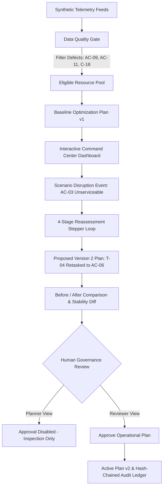

# VAYU-YUKTI — Dynamic Air Operations & Resource Optimisation

> **Permanent Operational Safety Notice:**  
> **Synthetic data · advisory only · not connected to any real system**

---

## 1. Overview & Problem Addressed

Aerospace logistics, disaster-relief airlift, medical evacuation, and aerial survey planning require rapid, mathematically validated resource coordination across dispersed operating bases. Operational planning frequently contends with:
- **Disparate, Partially Stale Telemetry Feeds:** Conflicting maintenance records, expired inspections, or missing payload/crew qualifications.
- **Dynamic Disruptions:** Unscheduled mechanical grounding of airframes or localized adverse weather windows that compromise scheduled missions.
- **Cascading Schedule Ripples:** Ad-hoc manual reassignments that inadvertently trigger collateral delays, crew duty overruns, or unfulfilled high-priority sorties.

**VAYU-YUKTI** is an aerospace resource-planning command centre prototype designed to ingest synthetic operational data, gate defective feeds through automated integrity checks, evaluate candidate resource allocations under hard operational constraints, and provide deterministic before/after plan stability diffs for authorized human review.

---

## 2. Project Objectives & Intended Users

### Core Objectives
1. **Unified Operational Picture:** Provide a single, consolidated aerospace command centre dashboard visualizing airbases, mission corridors, fleet serviceability, and weather restrictions.
2. **Automated Data-Quality Safeguards:** Prevent defective, stale, or conflicting maintenance telemetry from contaminating operational planning models.
3. **Transparent Reassessment Loop:** When an airframe becomes unserviceable, execute an automated 4-stage reassessment progression evaluating eligible replacement airframes under a strict plan-stability objective.
4. **Human-in-the-Loop Governance:** Enforce strict role-based separation of duties—Planners can formulate change scenarios and inspect diffs, but only authorized Reviewers can approve or reject plans into the active operational ledger.
5. **Cryptographic Provenance:** Maintain an append-only, verifiable audit chain of all ingestion, solving, and sign-off events.

### Intended Users
- **Air Operations Planners:** Responsible for drafting flight manifests, monitoring maintenance availability, and evaluating contingency reassessments.
- **Operations Reviewers / Directors:** Authority leads responsible for reviewing feasibility verifications, reviewing impact summaries, and providing mandatory approval.
- **Maintenance & Logistics Officers:** Field operators managing aircraft turnaround times, scheduled inspections, and capacity tracking.

---

## 3. Key Implemented Features

- **Interactive Synthetic Airspace Schematic Centerpiece (`AirOperationsMap.tsx`):**
  - Handcrafted SVG coordinate grid (960×440) featuring 3 fictional operational hubs (**Base Alpha**, **Base Bravo**, and **Base Charlie**).
  - 14 distinct mission flight corridors modeled with quadratic Bézier curves and animated aircraft tokens.
  - Interactive corridor/destination selection with an embedded quick-inspector drawer revealing mission payloads, assigned crew, and serviceability.
  - Visual hazard overlay for **CW-01 Bravo Ridge Winds (12:00–15:00 UTC)**, depicting rotary flight restriction windows.
  - Mission category filter pills (All, P1 Urgent, Relief & Medical, Logistics, Survey & Training).
- **Fleet Coordination Experience (`Resources.tsx`):**
  - Toggle between **Fleet Command Board** and **Sortie Data Table**.
  - Airframe readiness cards displaying payload capacity meters, maintenance hours remaining, crew qualifications, and assigned missions.
  - Flight crew qualification tracking (type certifications, rest intervals, and duty limits).
  - Embedded **Sortie Scheduling Matrix** visualizing aircraft utilization across the 24-hour mission window.
- **Data Quality Ingestion Gate (`DataQuality.tsx`):**
  - Automated detection of telemetry defects: `STALE` (observation timestamp exceeding threshold), `CONFLICT` (divergent readiness vs. maintenance statuses), and `MISSING_FIELD`.
  - Quarantines unverified assets to protect optimization models from bad data.
- **Multi-Stage Simulated Reassessment Progression (`ReassessmentStepperModal.tsx`):**
  - 4-stage modal sequence illustrating the end-to-end retasking loop:
    1. *Data Ingestion & Integrity Gate* (quarantining defective feeds).
    2. *Hard Constraint & Boundary Verification* (range, base collocation, payload capacity, weather window).
    3. *Candidate Allocation & Stability Evaluation* (scoring available replacement candidates).
    4. *Snapshot Sealing & Version 2 Generation* (creating an immutable plan snapshot).
- **Plan Timeline & Mathematical Explanation Drawer (`Plan.tsx`, `ExplanationDrawer.tsx`):**
  - Custom Gantt timeline mapping sorties across bases.
  - Detailed explanation drawer breaking down allocation reason codes (`R_ELIGIBLE`, `R_PRIORITY_COVERED`, `R_CAPACITY_CONFLICT`), rejected alternatives, and constraint checks.
- **Before/After Plan Comparison (`Compare.tsx`):**
  - High-visibility **Operational Impact & Root-Cause Summary** card detailing the ground event, retasked sortie, and ripple verification.
  - Synchronized dual stacked timelines comparing Version 1 (Baseline) and Version 2 (Proposed) on identical time axes with retask highlights.
  - Task-by-task delta diff table detailing previous vs. proposed airframes and stability indices.
- **Role-Separated Human Sign-off Workspace (`Review.tsx`, `ReviewPanel.tsx`):**
  - Dedicated reviewer panel requiring written operational comments before approval.
  - Role enforcement: Planners cannot approve or reject plans.
- **Simulated Cryptographic Audit Ledger (`Audit.tsx`):**
  - Visual vertical hash-chain timeline linking every ingestion, scenario creation, solve, and sign-off event with previous-hash digests.
  - Action filters and a one-click demo reset button to restore the deterministic baseline seed state.

---

## 4. How the Prototype Works



1. **Baseline State (Version 1):** The system initializes with 12 synthetic airframes, 18 flight crew members, and 14 support sorties across 3 bases. 3 seeded data-quality issues (`AC-09`, `AC-11`, `C-18`) are quarantined. Mission `T-04` (P1 Priority Relief) is assigned to `AC-03` at Base Alpha.
2. **Disruption Injection:** On the **Scenario & Changes** screen, the user triggers the preset event: `AC-03 → UNSERVICEABLE` (simulating pre-flight hydraulic degradation).
3. **Reassessment Loop:** The system executes the simulated 4-stage reassessment pipeline. Evaluating candidate airframes at Base Alpha, the engine selects reserve transport `AC-06` (8,000 kg capacity, qualified crew `C-07`/`C-08`).
4. **Diff Verification:** On the **Compare & Diff** screen, the user verifies that `T-04` is reassigned to `AC-06`, with a **100% Plan Stability Index** (all other 13 tasks remain untouched).
5. **Human Governance Sign-Off:** On the **Review & Sign-Off** screen, the user switches role from `Planner` to `Reviewer`, enters operational justification, and clicks **Approve Operational Plan**.
6. **Immutable Ledger Entry:** The approval event is appended to the simulated SHA-256 audit log, promoting Version 2 to active status and superseding Version 1.

---

## 5. Technology Stack

- **Framework:** React 18 (`react`, `react-dom`)
- **Language & Compiler:** TypeScript 5.7 (strict mode with `noUnusedLocals` and `noUnusedParameters`)
- **Bundler & Build Tool:** Vite 6 (`vite`, `@vitejs/plugin-react`)
- **Styling & Design System:** Tailwind CSS 3 (`tailwindcss`, `autoprefixer`, `postcss`)
- **Routing:** React Router DOM v6 (`react-router-dom`) with v7 future flags enabled
- **Icons & Visual Components:** Lucide React (`lucide-react`)
- **Testing Runtime:** Vitest 2 (`vitest`, `jsdom`, `@testing-library/react`, `@testing-library/jest-dom`, `@testing-library/dom`)
- **WASM Compatibility:** Rollup WebAssembly engine fallback (`@rollup/wasm-node`)

---

## 6. Architecture & Repository Structure

```text
VAYU-YUKTI/
├── .gitignore                      # Git exclusion rules (node_modules, dist, logs, env)
├── package.json                    # Workspace root scripts
├── README.md                       # Comprehensive project documentation
└── frontend/
    ├── index.html                  # HTML5 shell with title & viewport meta tags
    ├── package.json                # Frontend dependencies, scripts & overrides
    ├── postcss.config.js           # PostCSS Tailwind plugins
    ├── tailwind.config.js          # Tailwind design tokens & font definitions
    ├── tsconfig.json               # Strict TypeScript configuration
    ├── vite.config.ts              # Vite & Vitest configuration
    └── src/
        ├── index.css               # Global theme tokens, keyframes & reduced-motion rules
        ├── main.tsx                # React DOM root entrypoint
        ├── api/
            ├── mockFixtures.ts     # Seed data: 12 airframes, 18 crew, 14 tasks, bases, weather
            ├── mockService.ts      # State management, snapshot creation, solve logic, audit log
            └── mockTypes.ts        # Domain models & TypeScript interfaces
        ├── app/
            ├── App.tsx             # Root router & role provider
            ├── Layout.tsx          # Permanent safety banner, header, role switcher, navigation
            ├── RoleContext.tsx     # Demo Planner vs Reviewer role authorization
            └── routes.tsx          # Client-side route declarations
        ├── components/
            ├── AirOperationsMap.tsx # Interactive SVG synthetic airspace schematic centerpiece
            ├── ChangeForm.tsx      # Change submission form & preset event trigger
            ├── DiffTable.tsx       # Detailed task-by-task allocation diff
            ├── ExplanationDrawer.tsx # Reason code inspection & math explanation drawer
            ├── FlightRouteVisual.tsx # Looping SVG corridor animation widget
            ├── FreshnessBadge.tsx  # Telemetry freshness indicator
            ├── KpiTile.tsx         # Operational readiness KPI metric cards
            ├── RadarWidget.tsx     # Synthetic radar sweep visualizer
            ├── ReasonChip.tsx      # Interactive reason code badges
            ├── ReassessmentStepperModal.tsx # 4-stage reassessment progression modal
            ├── ReviewPanel.tsx     # Reviewer comment and approval/rejection controls
            ├── StatusBadge.tsx     # Operational status badges
            └── Timeline.tsx        # Handcrafted Gantt sortie visualization
        ├── lib/
            ├── format.ts           # Time formatting, duration, and priority color helpers
            └── reasonCodes.ts      # Reason code catalogue & plain-English descriptions
        ├── pages/
            ├── Audit.tsx           # Simulated cryptographic hash chain timeline
            ├── Compare.tsx         # Version 1 vs Version 2 diff & stability metrics
            ├── Dashboard.tsx       # Command centre overview with map centerpiece & KPI tiles
            ├── DataQuality.tsx     # Telemetry validation gate & discrepancy inspector
            ├── Plan.tsx            # Operational plan timeline & allocation manifest
            ├── Resources.tsx       # Fleet command board, capacity meters & sortie matrix
            ├── Review.tsx          # Human review workspace & run governance history
            └── Scenario.tsx        # Version snapshot history & retasking triggers
        └── test/
            ├── mockService.test.ts # Domain logic, stability index & version immutability tests
            ├── setup.ts            # Test environment setup & jest-dom Vitest matcher extension
            └── shell.test.tsx      # Banner, branding, navigation, and role switcher tests
```

---

## 7. Prerequisites & Installation

### Prerequisites
- **Node.js:** v18.x or v20.x or higher
- **npm:** v9.x or higher

### Installation Steps

1. **Clone the repository:**
   ```bash
   git clone https://github.com/yuva280/VAYU-YUKTI.git
   cd VAYU-YUKTI
   ```

2. **Install frontend dependencies:**
   ```bash
   cd frontend
   npm install
   ```

---

## 8. Local Development & Verification Commands

All commands should be executed from the `frontend` directory:

```bash
cd frontend
```

### 1. Start Local Development Server
```bash
npm run dev
```
Open [http://localhost:5173](http://localhost:5173) in your browser.

### 2. Run TypeScript Static Type Check
```bash
npx tsc --noEmit
```
Performs a full project type-check across all components, pages, and tests.

### 3. Run Automated Vitest Test Suite
```bash
npm test -- --run
```
Executes all 10 unit and integration tests covering synthetic banner rendering, navigation links, role switcher behavior, data-quality defect quarantine, version snapshot immutability, stability calculation, and audit chaining.

### 4. Build Production Bundle
```bash
npm run build
```
Executes `tsc && vite build`, creating optimized assets in `frontend/dist/`.

---

## 9. Walkthrough & Demo Guide

Follow this 5-minute evaluation script to demonstrate the prototype:

1. **Dashboard (`/`):**
   - Review the persistent safety banner: `Synthetic data · advisory only · not connected to any real system`.
   - Inspect the interactive **Synthetic Air Operations Airspace Schematic** centerpiece. Click on flight corridor `T-04` or destination `Sector-4 Relief Lifeline` to inspect the embedded sector card.
   - Note the 6 operational KPI tiles, radar status widget, and the Recent Decision Activity feed.
2. **Resources & Fleet Coordination (`/resources`):**
   - Toggle between **Fleet Command Board** and **Data Table**.
   - Inspect airframe `AC-03` at Base Alpha and check payload capacity meters and maintenance remaining hours.
   - View the embedded **Sortie Scheduling Matrix** showing mission allocations across the timeline.
3. **Data Quality Gate (`/data-quality`):**
   - Inspect the 3 seeded telemetry defects:
     - `AC-09`: **STALE** (observation >24h old; automatically excluded from allocation).
     - `AC-11`: **CONFLICT** (divergent telemetry reports; quarantined).
     - `C-18`: **MISSING_FIELD** (missing qualification record; quarantined).
   - Click each defect to view raw JSON telemetry evidence.
4. **Scenario & Retasking (`/scenario`):**
   - Click the preset button: **`AC-03 → UNSERVICEABLE`** (simulating pre-flight mechanical failure).
   - Observe the 4-stage reassessment modal executing: Data Ingestion Gate ➔ Hard Constraint Verification ➔ Candidate Evaluation ➔ Snapshot Sealing.
   - The application automatically generates Version 2 and navigates to the comparison view.
5. **Compare & Diff (`/compare`):**
   - Review the top-level **Operational Impact & Root-Cause Summary** card.
   - Inspect the stacked dual timelines comparing Version 1 and Version 2 side-by-side.
   - Observe that `T-04` is highlighted in amber and retasked to `AC-06`.
   - Check the **Plan Stability Index: 100%** (all 13 unaffected sorties remain unchanged).
6. **Human Governance Sign-Off (`/review`):**
   - While in the `Planner` role, note that approval authority is disabled with an informative security banner.
   - Switch role to **`Reviewer`** using the top-bar role selector.
   - Enter an operational review rationale in the comment box and click **Approve Operational Plan**.
   - Version 2 is marked `APPROVED`, and Version 1 is marked `SUPERSEDED`.
7. **Simulated Audit Ledger (`/audit`):**
   - Review the chronological audit chain linking each event via verifiable previous-hash digests.
   - Filter events by action type or click **Reset Demo to Baseline** to restore the deterministic seed state.

---

## 10. Synthetic Data & Simulation Details

All operational entities within VAYU-YUKTI are synthetic:
- **Bases:** Fictional logistics hubs (`Base Alpha`, `Base Bravo`, `Base Charlie`).
- **Airframes:** Fictional generic inventory (`AC-01` through `AC-12` across Heavy Transport, Utility Rotary, and Light Cargo types).
- **Crew:** Fictional personnel (`C-01` through `C-18` with synthetic flight hours, duty times, and qualification tags).
- **Missions:** Support operations only (Logistics Lift, Disaster Relief Supplies, Medical Transfer, Aerial Survey, Instrument Check).
- **Optimization Model:** The demonstration uses a client-side deterministic mock optimization service that simulates lexicographic multi-objective CP-SAT re-solving.
- **Audit Hashes:** The hash chain uses simulated SHA-256 digest strings linked consecutively to demonstrate provenance architecture.

---

## 11. Security, Limitations & Future Roadmap

### Current Prototype Limitations
- **Client-Side Simulation:** The current prototype operates entirely client-side in the browser using mock fixtures; there is no live backend server, PostgreSQL database, or remote OR-Tools service connected.
- **Pre-Seeded Disruption Path:** The primary dynamic re-solve path is deterministically calibrated around the `AC-03 → UNSERVICEABLE` scenario.
- **Simulated Cryptography:** Audit event hashes are generated deterministically in memory for demonstration purposes.

### Future Development Roadmap
1. **FastAPI & OR-Tools Backend Integration:** Connect the frontend to a Python FastAPI backend running Google OR-Tools CP-SAT for arbitrary dynamic constraint satisfaction.
2. **Hardware Cryptographic Ledger:** Transition simulated audit digests to real hardware-backed or server-side immutable SHA-256 merkle trees.
3. **Real-Time Telemetry Streaming:** Ingest live standard telemetry (e.g. MQTT/Kafka streams) into the data-quality gate with configurable alert thresholds.
4. **Enhanced Crew Rostering:** Model complex crew rest rules, duty-time limitations, and multi-leg sortie scheduling.

---

## 12. Contributing

Contributions are welcome! Please follow these guidelines:
1. Fork the repository and create a feature branch (`git checkout -b feature/enhancement-name`).
2. Adhere to strict TypeScript standards (`npx tsc --noEmit` must pass with 0 errors).
3. Ensure all tests pass (`npm test -- --run`).
4. Ensure the production build completes cleanly (`npm run build`).
5. Maintain the persistent synthetic data disclaimer and ensure no military tactical routing or live targeting features are introduced.
6. Open a Pull Request with a clear description of changes.

---

## 13. License

This project is licensed under the MIT License — see the repository files for details.

---

## 14. Project Status & Acknowledgements

- **Status:** Functional Frontend Prototype (Phases F0–F4 complete).
- **Disclaimer:** Built strictly for educational and demonstration purposes. All assets, coordinates, airbases, tail numbers, and scenarios are synthetic and advisory-only.
